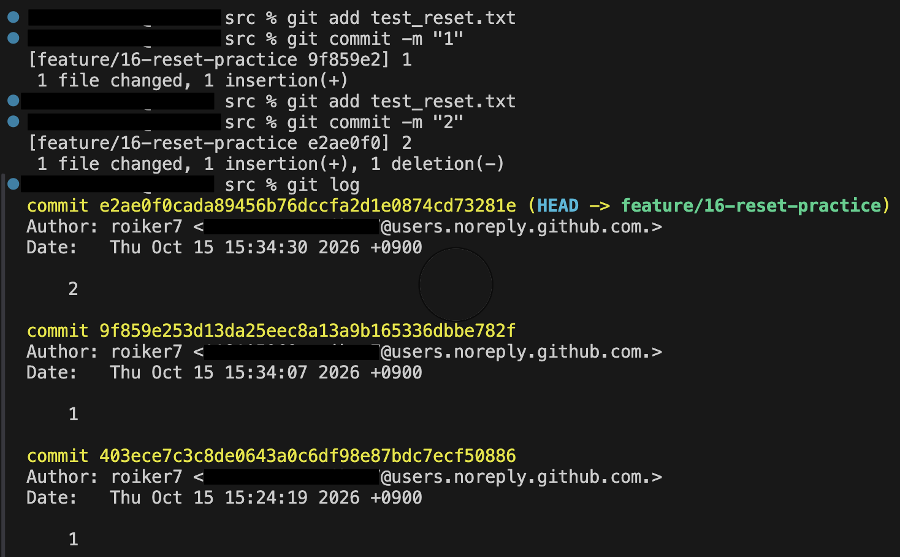
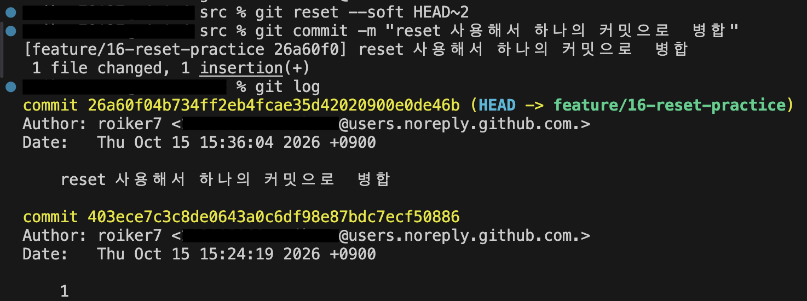

# Git 트러블슈팅 실습 기록

네 시나리오 모두 수행합니다. 모든 팀원은 최소 1개 시나리오의 해결 기록에 참여하고 자신의 이름 및 역할을 남깁니다.

실습은 안전한 개인 브랜치에서 수행합니다. 이미 공유된 커밋에 대한 amend/reset 및 무단 강제 Push를 금지합니다.

## 1. git commit --amend (최근 커밋 메시지 수정)

### 참여자 / 역할
- Patrick-sangwook
- 역할: `git commit --amend` 명령어를 이용한 최근 커밋 메시지 수정 실습 및 결과 기록

### 발생시킨 상황 / 기대한 복구
- 개인 학습자료를 작성한 후 커밋 메시지를 `어맨드 학습정리`로 등록함.
- 팀의 커밋 메시지 작성 규칙에 맞춰 `docs:` 접두어를 추가하고자 함.
- 기존 커밋의 파일 내용을 유지하면서 최근 커밋 메시지만 `docs: 어맨드 학습정리`로 수정하는 것을 목표로 함.

### 재현 절차 및 실제 실행 명령
1. `feature/12-amend-practice` 브랜치에서 최근 커밋을 확인함.
2. `git commit --amend`를 이용하여 커밋 메시지를 수정함.
3. 수정 후 `git log`로 커밋 메시지 및 커밋 ID 변경 여부를 확인함.

실습 명령어:

```bash
git log
git commit --amend -m "docs: 어맨드 학습정리"
git log
```

※ 가운데 `git commit --amend` 명령어는 제공된 실행 전후 로그를 바탕으로 정리한 재현용 명령어임.

### 실행 전 `git log`

**git log**

```text
commit ac8e2009dfa5aaa29b81d8c6d62abf0a80c27936 (HEAD -> feature/12-amend-practice)
Author: Patrick-sangwook <netlee12@naver.com>
Date:   Wed Oct 14 22:03:48 2026 +0900

    어맨드 학습정리
```

### 실행 후 `git log`

**git log**

```text
commit e41fc0a28abc98759a165a7b98ad902aba387113 (HEAD -> feature/12-amend-practice)
Author: Patrick-sangwook <netlee12@naver.com>
Date:   Wed Oct 14 22:03:48 2026 +0900

    docs: 어맨드 학습정리
```

### 결과 / 검증

| 구분 | 수정 전 | 수정 후 |
|---|---|---|
| 커밋 ID | `ac8e2009` | `e41fc0a2` |
| 커밋 메시지 | 어맨드 학습정리 | docs: 어맨드 학습정리 |
| 브랜치 | feature/12-amend-practice | feature/12-amend-practice |

**검증 결과**

- 최근 커밋 메시지가 정상적으로 변경됨.
- 커밋 ID가 `ac8e2009`에서 `e41fc0a2`로 변경됨.
- 작업 브랜치는 동일하게 유지됨.
- `git commit --amend`가 기존 커밋을 새로운 커밋으로 교체한다는 것을 확인함.

### 주의점
- `git commit --amend`는 최근 커밋을 새로운 커밋으로 교체하므로 커밋 ID가 변경됨.
- 이미 원격 저장소에 push한 커밋을 수정하면 다른 팀원의 Git 작업에 영향을 줄 수 있음.
- 가급적 원격 저장소에 push하기 전 개인 브랜치에서 사용해야 함.
- 공유 브랜치인 `main`에서는 팀원과 협의 없이 커밋 기록을 변경하거나 강제 push하지 않아야 함.
- 이번 실습을 통해 커밋 메시지 작성 규칙을 지키는 것의 중요성을 이해함.

## 2. git reset --soft HEAD~1 (로컬 커밋 취소, 변경 유지)
- 참여자 / 역할: 김상준 / reset 시나리오 실행 및 기록 작성
- 발생시킨 상황 / 기대한 복구:
  - 상황: 커밋 메시지를 잘못 쓰고 커밋함 (아직 push하지 않음)
  - 기대한 복구: 마지막 커밋 기록만 취소하고, 변경한 코드는 스테이징된 상태로 남겨서 메시지를 고쳐 다시 커밋
- 재현 절차 및 실제 실행 명령:
  1. 개인 브랜치에서 작업: `git switch -c feature/16-reset-practice`
  2. 파일 수정: `echo "reset 실습" >> test.txt`
  3. 스테이징 및 커밋(잘못된 메시지 생성1): `git add test.txt` → `git commit -m "1"`
  4. 스테이징 및 커밋(잘못된 메시지 생성2): `git add test.txt` → `git commit -m "2"`
  5. 커밋 취소: `git reset --soft HEAD~2`
  6. 올바른 메시지로 재커밋: `git commit -m "docs: reset 을 사용해서 하나의 커밋으로 병합"`
- 실행 전 `git log` / `git status`:
  - `git log --oneline`: `<해시> asdf` 커밋이 최상단에 보임
  - `git status`: `Your branch is ahead of 'origin/...' by 1 commit.` / `nothing to commit, working tree clean`
  - 
- 실행 후 `git log` / `git status`:
  - `git log --oneline`: `asdf` 커밋이 사라지고 이전 커밋이 최상단
  - `git status`: `Changes to be committed:` 아래에 `modified: test.txt`가 초록색(스테이징됨)으로 남아 있음
  - 
- 결과 / 검증:
  - 커밋 기록(메시지 포함)만 취소되고 파일 내용은 그대로 유지됨을 확인
  - 스테이징 상태가 유지되어 `git add` 없이 바로 `git commit` 가능
  - 재커밋 후 `git log --oneline`에서 새 메시지의 커밋 1개만 남음
- 주의점:
  - push하기 **전**의 로컬 커밋에만 사용 (push한 커밋에 쓰면 원격과 기록이 갈라져 강제 push가 필요해짐)
  - 푸시한 커밋을 되돌릴 때는 `git revert` 사용
  - `HEAD~N`의 N은 취소할 커밋 개수이며, 숫자를 크게 잡으면 의도보다 많은 커밋이 풀림 (코드는 유지됨)
  - `--mixed`(스테이징 해제), `--hard`(코드까지 삭제)와 구분해서 사용할 것

## 3. git revert (원격에 Push한 커밋 변경 취소)

- **참여자 / 역할:** [이름] — 문서 리팩토링 및 Revert 수행, [이름] — 리뷰 및 검증
- **원격 브랜치와 취소 대상 커밋(해시/링크):**
  - 관련 Issue: #XX
  - 최초 PR: #XX / 리팩토링 커밋: `[SHA]`
  - Revert PR: #XX / Revert 커밋: `[SHA]`

### 발생시킨 상황 / 기대한 복구

1. 트러블슈팅 문서를 단일 파일에서 주제별 파일로 분리하는 리팩토링을 수행하고 `main`에 병합하였다.
2. 이후 다른 팀원의 학습 문서가 `main`에 추가되었다.
3. 기존 단일 문서 구조가 과제 제출 기준에 더 적합하다고 판단하여 리팩토링을 철회하기로 했다.

**목표:** 기존 문서 구조를 복구하되, 이후 병합된 동료의 작업과 Git 이력은 유지한다.

### 재현 절차 및 실제 실행 명령

**1차 작업 — 리팩토링 및 PR 병합**

```bash
git switch -c feature/17-revert origin/main
# 문서 구조 변경
git add docs/
git commit -m "refactor: reorganize troubleshooting docs"
git push -u origin feature/17-revert
```

PR 생성 및 `main` 병합 → 동료의 학습 문서 PR 병합.

**2차 작업 — Revert 및 PR 병합**
94def06
```bash
git fetch origin
git switch -c revert/17-revert origin/main

git show --stat <TARGET_SHA> # 94def06
git revert <TARGET_SHA>

git log --oneline --graph -10
git show --stat HEAD
git push -u origin revert/17-revert
```

Revert PR 생성 → 리뷰 및 승인 → `main` 병합.

### 출력

```sh
commit 94def06ac8162bc576059cf1255e09e938ef0624 (origin/feature/17-revert, feature/17-revert)
Author: jhj91_09 <jhj91_09@naver.com>
Date:   Thu Oct 15 15:27:49 2026 +0900

    refactor: 트러블슈팅 구조 개편

 docs/troubleshooting/commit.md                            |  8 ++++++++
 docs/troubleshooting/reset.md                             |  8 ++++++++
 docs/troubleshooting/revert.md                            |  9 +++++++++
 docs/{troubleshooting-log.md => troubleshooting/stash.md} | 34 ----------------------------------
 4 files changed, 25 insertions(+), 34 deletions(-)
```

```sh
jhj91_093395@c4r1s6 troubleshooting % git log --oneline --graph -10
* 7b5cfe1 (HEAD -> revert/17-revert) Revert "refactor: 트러블슈팅 구조 개편"
*   22da3f8 (origin/main, origin/HEAD, main) Merge pull request #19 from jhj9109/feature/16-reset-practice
|\  
| *   ad20a65 (origin/feature/16-reset-practice) docs: 병합 충돌 해결
| |\  
| | * 4905570 docs: reset 학습정리
| * | 12ea697 docs: git reset 실습 후 관련 내용정리 추가
* | |   9b2464a Merge pull request #18 from jhj9109/feature/17-revert
|\ \ \  
| |_|/  
|/| |   
| * | 94def06 (origin/feature/17-revert, feature/17-revert) refactor: 트러블슈팅 구조 개편
|/ /  
* |   e3b0f0a (feature/15-troubleshooting-docs) Merge pull request #14 from jhj9109/feature/12-amend-practice
|\ \  
| |/  
|/|   
| * b35d672 (origin/feature/12-amend-practice) docs: 어맨드 학습정리
|/  
*   ea6c881 Merge pull request #13 from jhj9109/feature/11-README-UPDATE
|\ 

```

```sh
jhj91_093395@c4r1s6 troubleshooting % git show --stat HEAD
commit 7b5cfe1cc95c344bc9b538ed107a8f4e4711d012 (HEAD -> revert/17-revert)
Author: jhj91_09 <jhj91_09@naver.com>
Date:   Thu Oct 15 16:52:02 2026 +0900

    Revert "refactor: 트러블슈팅 구조 개편"
    
    This reverts commit 94def06ac8162bc576059cf1255e09e938ef0624.

 docs/{troubleshooting/stash.md => troubleshooting-log.md} | 34 ++++++++++++++++++++++++++++++++++
 docs/troubleshooting/commit.md                            |  8 --------
 docs/troubleshooting/reset.md                             |  8 --------
 docs/troubleshooting/revert.md                            |  9 ---------
 4 files changed, 34 insertions(+), 25 deletions(-)
```

## 4. git stash / git stash pop (작업 임시 보관·복원)

### 참여자 / 역할

- `wp230`: 이슈 #4 학습 노트 작성, PR #4 로컬 검토 및 리뷰 코멘트 작성, stash 실습 수행 및 기록 작성
- 실습일: 2026-10-14

### 발생시킨 상황 / 기대한 복구

`feature/4-additional-git-learning-note`에서 새 학습 노트를 작성하던 중,
다른 팀원의 PR #4를 로컬에서 검토해야 했다. 작성 중인 파일을 커밋하기 전에
보관하고 `review/pr-4`로 전환한 뒤, 원래 브랜치에서 작업을 복원하는 것이 목표였다.

처음에는 새 파일이 untracked 상태여서 기본 `git stash push`를 실행했을 때
`No local changes to save`가 출력되었다. 아래 명령으로 새 파일을 스테이징한 뒤
실습을 진행했다. `git add`는 커밋을 생성하지 않는다.

```bash
git add src/kwon-additional-git-learning-note.md
```

### 재현 절차 및 실제 실행 명령

실습은 아래 순서로 수행했다. `review/pr-4`는 실습 전에 PR #4의 head를
`git fetch origin pull/4/head:review/pr-4`로 가져와 준비한 로컬 브랜치다.
재현 시에는 해당 브랜치가 있는지 확인하고, 없으면 이 명령으로 준비한다.

```bash
git status
git diff --cached --stat
git stash push -m "docs: 학습 노트 작성 중 PR 4 검토를 위한 작업 보관"
git status
git stash list
git switch review/pr-4
git status
git log --oneline -5
# 로컬 파일 검토 후 GitHub PR #4에 리뷰 코멘트 작성
git switch feature/4-additional-git-learning-note
git stash pop
git status
git stash list
```

### 실행 전 `git status` / 작업 내용

다음은 실습 당시의 실제 출력이다. 당시 초안은 40줄이며, 이후 설명과 부록을
추가한 현재 학습 노트의 길이와는 다르다. 아래 코드 블록의 `$`는 프롬프트 표시다.

```text
$ git status
On branch feature/4-additional-git-learning-note
Changes to be committed:
  (use "git restore --staged <file>..." to unstage)
        new file:   src/kwon-additional-git-learning-note.md

$ git diff --cached --stat
 src/kwon-additional-git-learning-note.md | 40 ++++++++++++++++++++++++++++++++
 1 file changed, 40 insertions(+)
```

새 파일이 스테이징되어 있었지만 아직 커밋되지 않은 상태였다.

### 보관 후 상태 및 PR 검토 브랜치 전환

```text
$ git stash push -m "docs: 학습 노트 작성 중 PR 4 검토를 위한 작업 보관"
Saved working directory and index state On feature/4-additional-git-learning-note: docs: 학습 노트 작성 중 PR 4 검토를 위한 작업 보관
$ git status
On branch feature/4-additional-git-learning-note
nothing to commit, working tree clean
$ git stash list
stash@{0}: On feature/4-additional-git-learning-note: docs: 학습 노트 작성 중 PR 4 검토를 위한 작업 보관
$ git switch review/pr-4
Switched to branch 'review/pr-4'
$ git status
On branch review/pr-4
nothing to commit, working tree clean
$ git log --oneline -5
9e08232 (HEAD -> review/pr-4, origin/feature/2-learningFile) docs: 깃 기초 학습자료 문서 추가(jang)
7dffbf3 (origin/main, origin/HEAD, feature/4-additional-git-learning-note) Merge pull request #3 from jhj9109/feature/1-add-git-guide
3f77ad5 (origin/feature/1-add-git-guide, feature/1-add-git-guide) docs: add git fundamentals guide (kwon.md)
78c5f1f (main) chore: initialize team repository
```

작업을 보관한 뒤 작업 폴더가 깨끗해지고 stash 항목이 1개 생성된 것을 확인했다.
`review/pr-4`에서는 PR #4의 커밋 `9e08232`를 확인했다.

### 실행 후 `git status` / 복원 확인

PR #4에 리뷰 코멘트를 작성한 뒤 작업 브랜치로 돌아왔다.

```text
$ git switch feature/4-additional-git-learning-note
Switched to branch 'feature/4-additional-git-learning-note'
$ git stash pop
On branch feature/4-additional-git-learning-note
Changes to be committed:
  (use "git restore --staged <file>..." to unstage)
        new file:   src/kwon-additional-git-learning-note.md

Dropped refs/stash@{0} (174702226d7ac69d67e56bb3c050da885d42c884)
$ git status
On branch feature/4-additional-git-learning-note
Changes to be committed:
  (use "git restore --staged <file>..." to unstage)
        new file:   src/kwon-additional-git-learning-note.md

$ git stash list
```

마지막 `git stash list`에는 출력이 없었다. 이는 보관 항목이 제거됐다는 뜻이다.

### 결과 / 검증

- 보관 직후 작업 폴더가 깨끗해지고 stash 항목이 생성됐다.
- PR 검토 브랜치로 전환하여 다른 팀원의 학습 자료를 확인했다.
- 원래 브랜치에서 학습 노트가 복원됐으며, 이번 실행에서는 새 파일이 스테이징 상태로 돌아왔다.
- `Dropped refs/stash@{0}` 출력과 빈 stash 목록으로 적용 후 항목 제거를 확인했다.

### 주의점

- 기본 stash는 untracked 파일을 포함하지 않는다. 새 파일은 `git add`로 스테이징하거나
  `git stash push -u`로 포함할 수 있다. 이번 실습에서는 `git add`를 사용했다.
- 이번 새 파일의 스테이징 복원 결과를 모든 변경에 일반화하지 않는다.
  기존 스테이징 상태까지 복원하려는 경우 `git stash pop --index`를 사용한다.
- `git stash pop` 중 충돌이 발생하면 stash 항목이 유지될 수 있다. 충돌을 해결하고
  파일 내용과 `git stash list`를 확인한 뒤 필요한 경우 해당 항목을 제거한다.
- 로그의 브랜치 포인터와 해시는 실습 당시 상태다. 이후 PR 병합으로 현재 이력은 달라질 수 있다.

### 관련 링크

- [이슈 #4: 추가 Git 학습 노트 및 stash 실습](https://github.com/jhj9109/cody_git_team/issues/4)
- [PR #4: 검토한 팀원의 Git 학습 자료](https://github.com/jhj9109/cody_git_team/pull/4)
- [PR #7: stash 학습 노트 추가](https://github.com/jhj9109/cody_git_team/pull/7)
- [학습 노트 및 실습 부록](../src/kwon-additional-git-learning-note.md)
